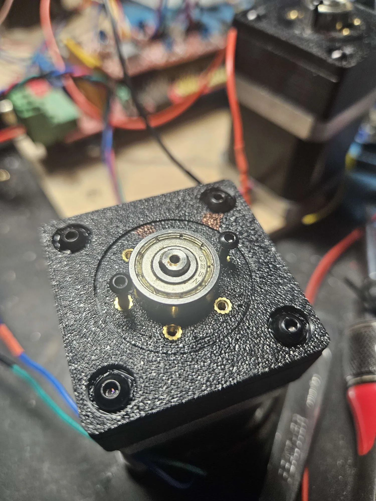
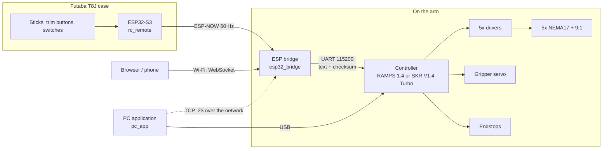

# 🦾 Robotic arm

[Latviski](README.md) | **English**

A 5-axis robotic arm driven by NEMA17 steppers (two types: 17HM5417, 0.9°, and RB 17HD0004-6) through 3D-printed
gearboxes (9:1 cycloidal and 4:1 planetary; motor steps and gear ratio are set per joint), with its own firmware for RAMPS 1.4 / BTT SKR V1.4 Turbo. It can be controlled from a **PC application** over USB
or the network (similar to Printrun), from a **web browser** (phone/PC) or from a rebuilt **Futaba T8J RC
transmitter** (ESP32-S3, ESP-NOW).

> Detailed documentation in [docs/](docs) is written in Latvian; the user interfaces are in Latvian as well.


*The rebuilt Futaba T8J remote (searching for the arm…), RAMPS 1.4, Wemos D1 mini bridge, motors with 3D-printed gearboxes and the J1 base.*

## How it started

About 13 years ago I was building my own 3D printers. These days there is a Bambu on the desk, but the
shelves are still full of parts from those years: RAMPS and SKR boards, drivers, NEMA17 motors, endstops,
power supplies. Over time I experimented with all kinds of controllers and motors, and throwing it all
away never felt right. So the idea was simple: build a robotic arm from what is already there.

I didn't use printer firmware for the arm. Together with the AI assistant Claude, a dedicated firmware was
written that works with joints and degrees instead of XYZ axes: endstops with HOME to the middle position,
synchronized moves, teach and playback. The same code runs on both the old RAMPS 1.4 and the SKR V1.4 Turbo.

The remote has its own story. A Futaba T8J transmitter once got the wrong battery, as far as I remember a
2S 7.4 V pack that it was never meant to take, and the transmitter burned out. The mechanics, however,
were excellent: precise gimbals, good switches, a comfortable case. So the electronics were replaced with
an ESP32-S3 and a colour screen, while the original Futaba button board keeps working. Now the remote
Ironically, it now runs on a 2S battery (2×18650 through an LM2596).

**Status:** the electronics, firmware, PC application and remote already work. The mechanics of the arm are
still in progress: both motor types and both gearboxes (9:1 cycloidal and 4:1 planetary) are being tested to find out what suits
each joint best.

| | | |
|---|---|---|
|  |  |  |
| J1 base with the endstop holder | 3D-printed gearbox on a motor | RB 17HD0004-6, lot 130403, left over from the printer days |



## Repository layout

| Folder | What it is | Build |
|---|---|---|
| [firmware/controller](firmware/controller) | Motion controller: step generator, manual motion, synchronized moves, limits, endstops/HOME, TMC2209 UART | `pio run -e ramps14` / `-e skr14turbo` |
| [firmware/controller/sim](firmware/controller/sim) | The same firmware running on a PC: test suite and a **virtual arm** for the PC application | `pio run -e sim` / `-e virtual` |
| [pc_app](pc_app) | **PC application** (Python + Qt): control, configuration, endstops, programs, remote settings | `pc_app\start.bat` |
| [firmware/esp32_bridge](firmware/esp32_bridge) | Bridge on the arm (ESP32 / ESP32-S3 / Wemos D1 mini): Wi-Fi, web page, TCP link for the PC app, remote receiver | `-e espnow`, `-e s3_espnow`, `-e d1mini` … |
| [firmware/rc_remote](firmware/rc_remote) | ESP32-S3 inside the Futaba T8J: sticks, 12 trim buttons, switches (HC4067), colour screen, Wi-Fi OTA → ESP-NOW | `-e s3` / `-e s3_ota` |
| [firmware/common](firmware/common) | Shared radio packet format | — |
| [futaba_shemas](futaba_shemas) | EasyEDA schematics of the transmitter rebuild (ESP board + original Futaba button board) | — |
| [cad](cad) | Mechanical parts | — |
| [docs](docs) | Wiring, protocol, PC application, LCD/SD (in Latvian) | — |

Everything is built with [PlatformIO](https://platformio.org/) (VS Code extension or the `pio` CLI).

## Features

**Controller** (one code base for both boards)
- Fixed-rate step ISR (DDA): RAMPS 16 kHz (up to ~50°/s at 1/16 microstepping), SKR 50 kHz (up to 156°/s).
- **JOG** (velocity) mode for the remote and buttons: acceleration ramps, braking *before* the software limit,
  and a watchdog: the arm stops by itself if no new JOG command arrives within 300 ms.
- **MOVE** mode: queued point-to-point moves, all joints start and finish **at the same time**.
- Double limit protection: in the planner and in the ISR, which refuses to step outside the limits.
- ESTOP (`!` works even in the middle of a line), STOP with controlled deceleration.
- **Endstops and HOME**: fast + slow approach, homing order, NO/NC. After HOME the joint drives to **0 = its
  middle position**; setting zero anywhere afterwards recalculates and saves the endstop angle.
  Hitting an endstop during motion is a soft stop (no alarm): you can drive away from it without a reset.
  J1 can use a single endstop that is hit from either side.
- Lines from the bridge carry a checksum: a corrupted line is rejected instead of executed.
- Settings are stored in the controller (`SAVE`): Mega EEPROM / SKR flash.
- SKR: TMC2209 over UART (microsteps, current, SpreadCycle/StealthChop).
- **LCD** (RepRapDiscount 20×4 + encoder): status, menu, jogging, HOME/zero, **programs from the SD card
  without a PC**.

**PC application** ([pc_app](pc_app), Python + PySide6)
- Manual motion, steps, target positions, HOME/zero, gripper, position bars for every joint.
- Parameter table with endstop test and SAVE.
- Program editor with teaching (+ Position), pauses, HOME and raw commands; repeat, pause, single step;
  `.rrprog` files.
- **Remote** tab (when connected through the bridge over the network): live view of sticks, buttons and
  switches, and assignment of trim buttons / sticks to joints.
- **Virtual arm** button: runs the real firmware on the PC, so everything can be tried without hardware.

**ESP bridge**
- Wi-Fi AP `RobotRoka` (password `robotroka`) → http://192.168.4.1 or http://robotroka.local;
  can also join a home network.
- Web page: manual motion, target positions, gripper, **teach and playback**, configuration, HOME, console,
  remote settings.
- TCP port 23: the PC application can control the arm over the network.
- The remote has priority over web/PC manual motion.

**Remote** (Futaba T8J case, ESP32-S3 N16R8)
- 2 sticks + potentiometer, 12 trim buttons (original button board with BU4051), 5 two-position and
  2 three-position switches plus a momentary switch through a CD74HC4067, RGB LED, buzzer.
- 1.69" ST7789 colour screen: link, battery, speed, mode and the position of every joint.
- ARM and ESTOP switches; it refuses to start until all switches are in their home positions.
- HOME / RESET from the remote, trim buttons nudge individual joints and the gripper.
- Stick calibration on the remote itself; firmware update over Wi-Fi (OTA), so the case can stay closed.

## Quick start

1. **Controller.** Check microsteps (RAMPS: must match the jumpers!) and limits in `config.h`.
   - RAMPS: `cd firmware/controller` → `pio run -e ramps14 -t upload`
   - SKR: `pio run -e skr14turbo` → copy `.pio/build/skr14turbo/firmware.bin` to the SD card →
     power the board (after a successful flash the file is renamed to `FIRMWARE.CUR`).
2. **PC application:** `pc_app\start.bat` → choose the COM port → Connect.
   Or any serial terminal at 115200, line ending `\n`:
   ```
   INFO
   ENABLE
   JOG 20 0 0 0 0      ; J1 turns slowly (stops by itself after 0.3 s)
   ?                   ; status
   ```
   Check the direction of every axis (`CFG INVERT n 1` if reversed).
3. **Zero.** Put the arm in its start pose → `ZERO`, or configure endstops and run `HOME`. `MOVE` and limits
   work only after that; until then manual motion runs at 30% speed without limits. Store settings with `SAVE`.
4. **ESP bridge:** `cd firmware/esp32_bridge` → `pio run -e d1mini -t upload` (or `-e espnow` for ESP32).
   Wire it as shown in [docs/elektronika.md](docs/elektronika.md), open http://192.168.4.1.
5. **Remote:** `cd firmware/rc_remote` → `pio run -e s3 -t upload --upload-port COMx`.
   Later updates over Wi-Fi: power on while holding H → `pio run -e s3_ota -t upload --upload-port <IP>`.
   `RC_NET_ID` must match on both sides.

> ⚠️ RAMPS (Mega) resets when a PC opens its serial port → the position is lost (`ZERO` or `HOME`).
> The position is also lost after a power cycle; with endstops a single `HOME` restores it.

## Defaults

| | J1 | J2 | J3 | J4 | J5 |
|---|---|---|---|---|---|
| Limits, ° | ±170 | ±90 | ±135 | ±120 | ±180 |
| Speed, °/s | 45 | 30 | 45 | 60 | 90 |
| Acceleration, °/s² | 60 | 40 | 60 | 120 | 180 |
| Current (SKR), mA RMS | 1000 | 1000 | 1000 | 800 | 800 |

Steps per degree: 400 × microsteps × 9 / 360 → **160** (1/16 microstepping on both RAMPS and SKR).

## Roadmap

- [ ] Kinematics (DH parameters) → manual motion in XYZ and a 3D view in the web page
- [x] Endstops and `HOME`
- [x] PC application with a program editor
- [x] Rebuilt Futaba remote with screen and OTA
- [ ] Teach / playback from the remote (switch C)
- [ ] Storing programs on the bridge (playback without an open browser)

## License

GPL-3.0, see [LICENSE](LICENSE). You may use and modify the code freely, provided that modified versions are
published under the same license.
