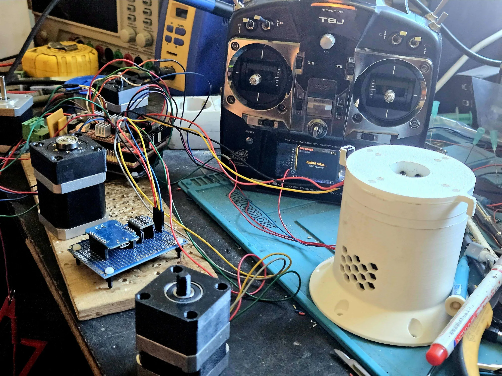
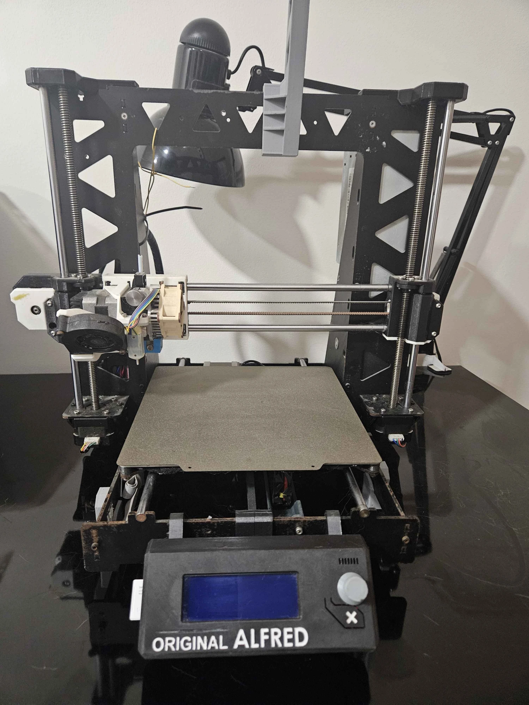
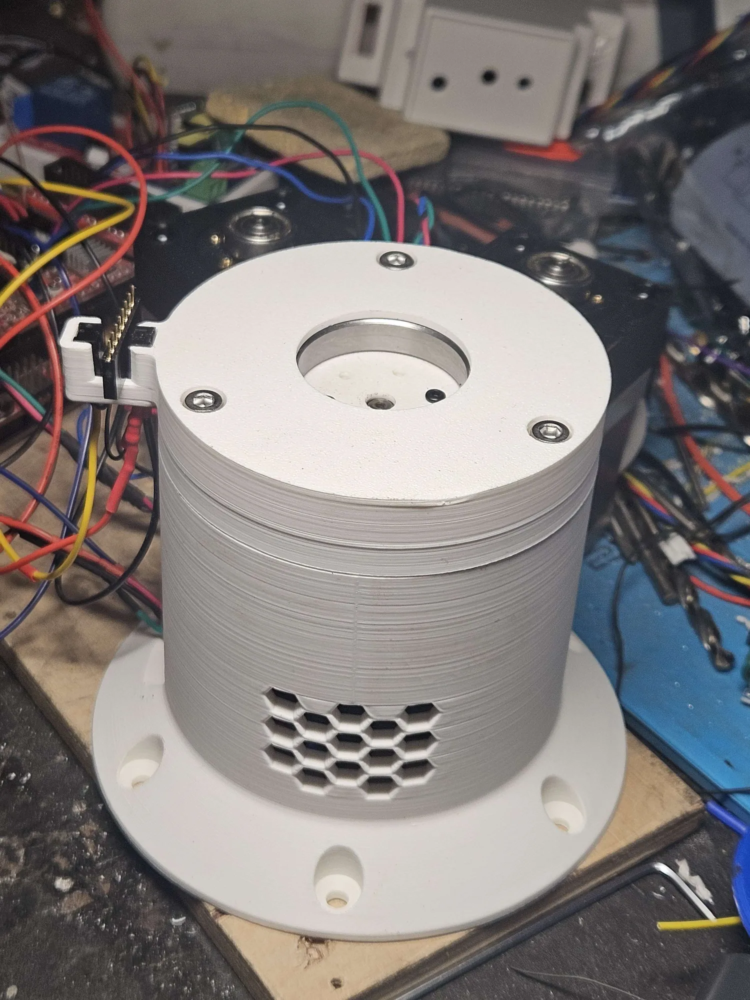
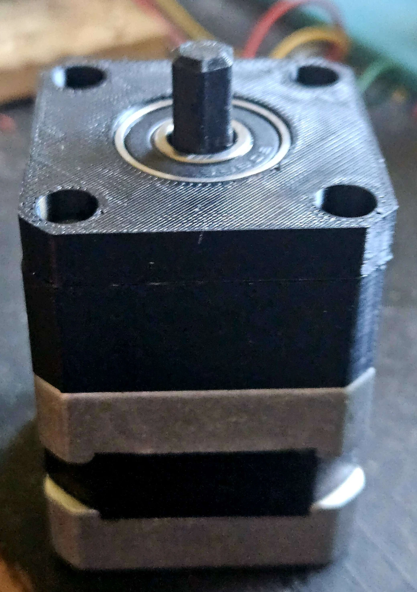
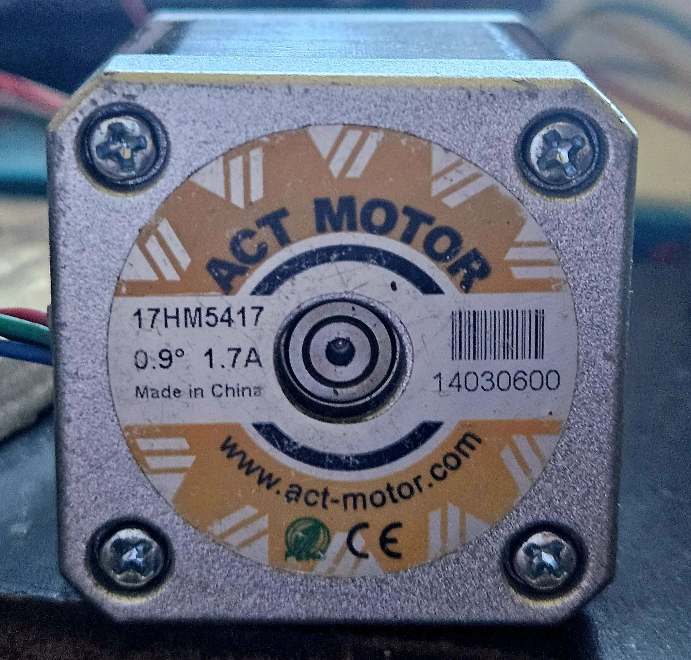
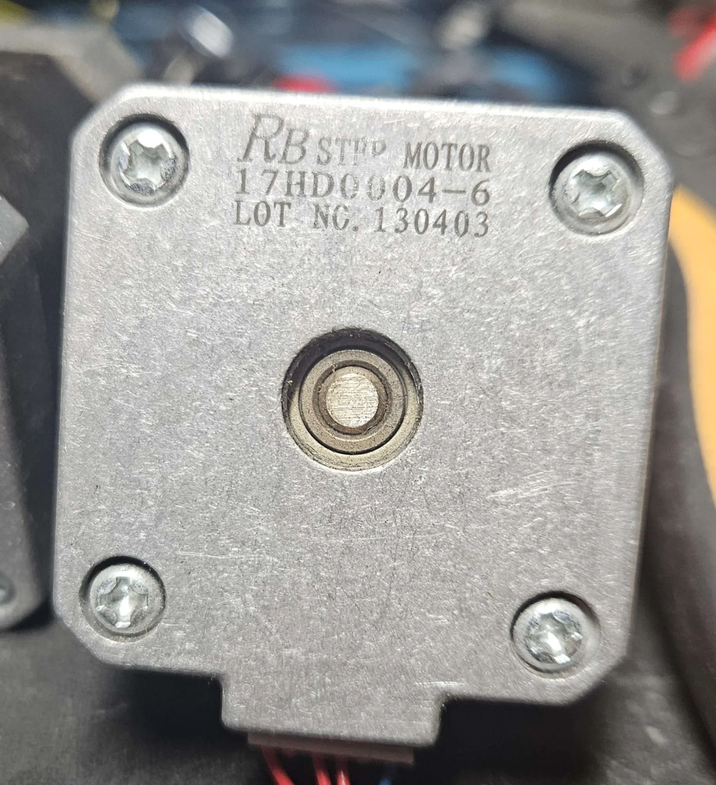
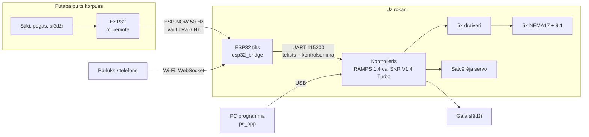

# 🦾 Robot roka

**Latviski** | [English](README.en.md)

5 asu robotroka ar NEMA17 soļu motoriem (divu veidu: 17HM5417, 0.9°, un RB 17HD0004-6) un drukātiem reduktoriem —
9:1 cikloidālo un 4:1 planetāro. Motora soļi un reduktors katrai locītavai ir iestatāmi atsevišķi.
Vadība no **PC programmas** caur USB (kā Printrun), no **web pārlūka** (telefons/dators) vai no pārveidotas
**Futaba RC pults** (ESP-NOW vai LoRa).


*Pārbūvētā Futaba T8J pults („meklē roku…”), RAMPS 1.4, Wemos D1 mini tilts, motori ar drukātiem reduktoriem un J1 pamatne.*

## Kā tas radās

Pirms kādiem 13 gadiem es pats būvēju 3D printerus. Tagad uz galda stāv Bambu, bet no tiem laikiem
plauktos palika kaudze detaļu: RAMPS un SKR plates, draiveri, NEMA17 motori, gala slēdži, barošanas bloki.
Gadu gaitā tika izmēģināti visdažādākie kontrolieri un motori, un izmest to visu nebija prāta.
Tā radās ideja: no tā, kas jau ir, uzbūvēt robotroku.



*Viens no paša būvētajiem printeriem — „Original Alfred”.*

Printera programmu rokai neizmantoju. Kopā ar AI asistentu Claude tika uzrakstīts savs firmware,
kas strādā ar locītavām un grādiem, nevis XYZ asīm: gala slēdži ar HOME uz vidu, sinhronas kustības,
mācīšana un atskaņošana. Tas pats kods iet gan uz vecā RAMPS 1.4, gan uz SKR V1.4 Turbo.

Pultij ir savs stāsts. Futaba T8J raidītājs kādreiz cieta, kad kāds tajā ielika nepareizu bateriju,
cik atceros, 2S 7.4 V, ko tur likt nedrīkstēja. Raidītājs nodega, bet mehānika palika lieliska:
precīzi stiki, kvalitatīvi slēdži, ērts korpuss. Tāpēc elektroniku nomainīju pret ESP32-S3 ar
krāsu ekrānu, un Futabas pogu plate strādā tālāk. Ironiski, tagad pults barojas tieši no 2S baterijas (2×18650 caur LM2596).

**Stāvoklis:** elektronika, firmware, PC programma un pults jau strādā. Rokas mehānika vēl tikai top —
pašlaik tiek testēti abi motoru veidi un abi reduktori (9:1 cikloidālais un 4:1 planetārais),
lai saprastu, kas katrai locītavai der vislabāk.

| | | |
|---|---|---|
|  |  |  |
| J1 pamatne ar gala slēdža turētāju | Drukāts 9:1 cikloidālais reduktors | Drukāts 4:1 planetārais reduktors ar sešstūra vārpstu |
|  |  | |
| ACT Motor 17HM5417, 0.9°, 1.7 A | RB 17HD0004-6, partija 130403 — no printeru laikiem | |



## Kas ir mapē

| Mape | Kas tas ir | Būve |
|---|---|---|
| [firmware/controller](firmware/controller) | Kustību kontrolieris: soļu ģenerators, manuāla kustība, sinhronizētas kustības, limiti, TMC2209 UART | `pio run -e ramps14` / `-e skr14turbo` |
| [pc_app](pc_app) | **PC programma**: vadība, konfigurācija, gala slēdži, programmas ([apraksts](docs/pc_programma.md)) | `pc_app\start.bat` |
| [firmware/controller/sim](firmware/controller/sim) | Firmware uz datora: simulācija (205 pārbaudes) un **virtuālā roka** PC programmai | `pio run -e sim` / `-e virtual` |
| [firmware/esp32_bridge](firmware/esp32_bridge) | Tilts uz rokas (ESP32 / ESP32-S3 / D1 mini): Wi-Fi + web lapa + pults uztvērējs | `-e espnow`, `-e s3_espnow`, `-e d1mini` … |
| [firmware/rc_remote](firmware/rc_remote) | ESP32-S3 Futaba T8J pultī: stiki, pogas, slēdži (HC4067), krāsu ekrāns → ESP-NOW | `-e s3` |
| [firmware/common](firmware/common) | Kopīgais radio pakešu formāts | — |
| [docs/elektronika.md](docs/elektronika.md) | Pieslēgumi, jumperi, barošana | |
| [docs/protokols.md](docs/protokols.md) | Visas komandas un atbildes | |
| [docs/pc_programma.md](docs/pc_programma.md) | PC programmas lietošana, gala slēdžu iestatīšana | |
| [docs/ekrans.md](docs/ekrans.md) | Ekrāns ar grozāmo pogu, izvēlne, programmas no SD kartes | |

Viss tiek būvēts ar [PlatformIO](https://platformio.org/) (VS Code paplašinājums vai `pio` komandrinda).

## Galvenās īpašības

**Kontrolieris** (viens kods abām platēm)
- Fiksētas frekvences soļu ISR (DDA): RAMPS 16 kHz (līdz ~50°/s pie 1/16 mikrosoļa),
  SKR 50 kHz (līdz 156°/s pie 1/16).
- **JOG** režīms (ātrums) pultij un web pogām: paātrinājuma rampas, bremzē *pirms*
  programmatūras limita, **sargsuns** — ja 300 ms nav jaunas JOG komandas, roka apstājas pati.
- **MOVE** režīms: punkts-punkts kustības rindā, visas locītavas sāk un beidz **vienlaicīgi**.
- Divkārša limitu aizsardzība: plānotājs + ISR, kas fiziski atsakās spert soli ārpus robežām.
- ESTOP (`!` simbols strādā pat rindas vidū), STOP ar kontrolētu bremzēšanu.
- SKR: TMC2209 caur UART — mikrosoļi, strāva, SpreadCycle/StealthChop; periodiski pārbauda
  draiverus un tos pārkonfigurē, ja motoru barošana ieslēgta vēlāk.
- Rindas no ESP32 ar kontrolsummu — bojāta rinda tiek noraidīta, nevis izpildīta kļūdaini.
- **Gala slēdži un HOME** (ātrā + lēnā pieeja, secība, NO/NC); pēc HOME locītava aizbrauc uz **0 = vidus**.
  Slēdzis kustības laikā → apstāšanās bez trauksmes, no slēdža var aizbraukt bez RESET.
- Iestatījumi saglabājas **kontroliera atmiņā** (`SAVE`): Mega EEPROM / SKR flash.
- **Ekrāns** (3D printera RepRapDiscount 20×4 + grozāmā poga): statuss, izvēlne, locītavu kustināšana,
  HOME/nulle, **programmas no SD kartes bez datora** ([apraksts](docs/ekrans.md)).

**PC programma** ([pc_app](pc_app), Python + Qt): manuāla kustība ar bultiņām, soļi, mērķi, HOME, satvērējs; parametru tabula ar
gala slēdžu pārbaudi un SAVE; programmu redaktors ar mācīšanu (+ Pozīcija), pauzēm, HOME un komandām,
atkārtošanu, pauzi un soli pa solim; faili `.rrprog`; konsole. Poga **Virtuālā roka** palaiž īsto firmware uz
datora — var visu izmēģināt bez dzelžiem.

**ESP32 tilts**: Wi-Fi AP `RobotRoka` (parole `robotroka`) → http://192.168.4.1 vai
http://robotroka.local. Web lapā: manuāla kustība, mērķa pozīcijas, satvērējs, **mācīšana un atskaņošana**
(punktu programma, eksports/imports JSON), konfigurācija (SAVE kontrolierī), HOME, konsole.
Pults ar prioritāti pār web manuālo kustību.

**Pults** (Futaba T8J korpuss, ESP32-S3): 2 stiki + potenciometrs, 12 trima pogas, 5 divpozīciju un 2 trīspozīciju
slēdži + spiedpoga H, krāsu ekrāns ar locītavu pozīcijām, ARM un ESTOP slēdži (neieslēdzas, ja slēdži nav
sākuma pozīcijās), HOME/RESET no pults, stiku kalibrācija, firmware ielāde caur Wi-Fi (OTA), ESP-NOW kanāla
automātiska meklēšana. Shēmas: [futaba_shemas](futaba_shemas).

## Ātrais starts

1. **Kontrolieris.** `config.h` pārbaudi mikrosoļus (RAMPS: jāsakrīt ar jumperiem!) un limitus.
   - RAMPS: `cd firmware/controller` → `pio run -e ramps14 -t upload`
   - SKR: `pio run -e skr14turbo` → nokopē `.pio/build/skr14turbo/firmware.bin` uz SD karti →
     ieslēdz plati (pēc veiksmīgas ielādes fails pārsaucas par `FIRMWARE.CUR`).
2. **PC programma:** `pc_app\start.bat` → izvēlies COM portu → Pieslēgties ([apraksts](docs/pc_programma.md)).
   Vai jebkurš seriālais monitors 115200, rindas beigas `\n`:
   ```
   INFO
   ENABLE
   JOG 20 0 0 0 0      ; J1 lēnām griežas (apstājas pats pēc 0.3 s)
   ?                   ; statuss
   ```
   Pārbaudi katras ass virzienu (`CFG INVERT n 1`, ja otrādi).
3. **Nulle.** Noliec roku sākuma pozā → `ZERO`, vai iestati gala slēdžus un `HOME`. Tikai tad strādā
   `MOVE` un limiti. Līdz tam manuālā kustība strādā ar 30% ātrumu un bez limitiem. Iestatījumus saglabā ar `SAVE`.
4. **ESP32 tilts:** `cd firmware/esp32_bridge` → `pio run -e espnow -t upload`.
   Pieslēdz pēc [docs/elektronika.md](docs/elektronika.md), atver http://192.168.4.1.
5. **Pults:** `cd firmware/rc_remote` → `pio run -e s3 -t upload --upload-port COMx`. Kalibrē (BOOT 2 s).
   `RC_NET_ID` abās pusēs jābūt vienādam.

> ⚠️ RAMPS (Mega) pārstartējas, kad datorā atver seriālo portu → pozīcija pazūd (`ZERO` vai `HOME`).
> Pozīcija pazūd arī pēc barošanas izslēgšanas — ar gala slēdžiem to atjauno viena `HOME` komanda.

## Noklusējuma vērtības

| | J1 | J2 | J3 | J4 | J5 |
|---|---|---|---|---|---|
| Limiti, ° | ±170 | ±90 | ±135 | ±120 | ±180 |
| Ātrums, °/s | 45 | 30 | 45 | 60 | 90 |
| Paātrinājums, °/s² | 60 | 40 | 60 | 120 | 180 |
| Strāva (SKR), mA RMS | 1000 | 1000 | 1000 | 800 | 800 |

Soļi uz grādu: 400 × mikrosoļi × 9 / 360 → **160** (1/16 mikrosolis gan RAMPS, gan SKR).

## Tālākie soļi

- [ ] Kinemātika (DH parametri), kad būs zināma rokas ģeometrija → manuāla kustība XYZ koordinātās un 3D skats web lapā
- [x] Gala slēdži / Hall sensori un `HOME` komanda
- [x] PC programma ar programmu redaktoru
- [ ] Programmu glabāšana ESP32 (lai atskaņo arī bez atvērta pārlūka)

## Licence

GPL-3.0 - skat. [LICENSE](LICENSE). Kodu drīkst brīvi izmantot un mainīt, ja arī izmainītais kods tiek publicēts ar to pašu licenci.
