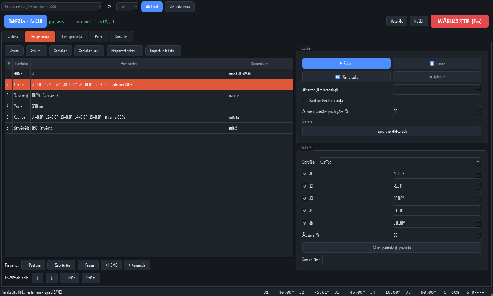

# PC programma (RobotRoka PC)

Kā Printrun/Pronterface, tikai robotrokai: pieslēdzas kontrolierim caur **USB** (RAMPS vai SKR)
un ļauj vadīt roku, iestatīt gala slēdžus un visus parametrus, kā arī sastādīt un izpildīt
**programmas** (darbību secības).



## Palaišana

1. Vajag **Python 3.9+** (https://www.python.org, instalējot atzīmē "Add to PATH").
2. Dubultklikšķis uz [`pc_app/start.bat`](../pc_app/start.bat). Pirmajā reizē tas izveido vidi
   `pc_app/.venv` un instalē PySide6 + pyserial (~150 MB), pēc tam palaiž programmu.

Komandrindā: `pc_app\.venv\Scripts\python pc_app\robotroka_pc.py`

## Pieslēgšanās

Iesprauž USB vadu - plate parādās kā COM ports (nekādi papildu draiveri nav vajadzīgi, tāpat kā Arduino IDE).
Augšā izvēlies to (RAMPS = Arduino Mega, SKR = "USB Serial Device"), 115200, **Pieslēgties**.
- RAMPS pēc porta atvēršanas pārstartējas (~2 s) — pozīcija jāuzstāda no jauna (ZERO vai HOME).
- **Virtuālā roka** (nav obligāta, tikai izmēģināšanai bez dzelžiem) palaiž firmware uz datora un pieslēdzas tam. Tai ir
  virtuāli gala slēdži (J1..J5 pie ±100/80/120/110/160° no starta pozas) — var izmēģināt visu, arī HOME.
  Vispirms to uzbūvē: `cd firmware/controller/sim` → `pio run -e virtual`.

### Caur mājas tīklu (bez USB vada)

Ja ESP tilts ir pieslēgts mājas tīklam, PC programma var vadīt roku caur tīklu — datoram pašam
Wi-Fi nevajag, pietiek ar vadu uz rūteri.

1. Ar telefonu pieslēdzies Wi-Fi **RobotRoka** (parole `robotroka`) → http://192.168.4.1 →
   cilne **Wi-Fi / info** → ieraksti mājas tīkla nosaukumu un paroli → "Saglabāt un restartēt".
   (Vai ieraksti tos `firmware/esp32_bridge/include/config.h`: `WIFI_STA_SSID` / `WIFI_STA_PASS`.)
2. PC programmā izvēlies **"Tilts tīklā (robotroka.local)"** → Pieslēgties.
   Ja dators nevar atrast `robotroka.local`, ieraksti adresi no web lapas rindas `pc=`, piem.
   `socket://192.168.1.57:23`.

Tilta paša tīkls **RobotRoka paliek ieslēgts** arī tad, un **pults (ESP-NOW) turpina strādāt**:
tilts pāriet uz rūtera Wi-Fi kanālu, un pults to atrod pati. Vienlaikus var būt pieslēgta
PC programma (līdz 2), web lapas un pults — katrs saņem atbildes tikai uz savām komandām.
Ja pults aktīvi vada roku, PC un web manuālā kustība tiek ignorēta.

**AVĀRIJAS STOP** (vai taustiņš **Esc**) vienmēr redzams augšā labajā pusē.

## Cilnes

### Vadība
- **◀ ▶** — turi, lai locītava brauktu (manuāla kustība, sūta JOG 10x sekundē; atlaižot — apstājas; ja programma "uzkaras",
  kontrolieris apstājas pats pēc 0.3 s).
- **− +** — solis par izvēlēto lielumu (0.1°–90°).
- **Mērķis + Iet** — viena locītava; **Iet uz visiem mērķiem** — visas vienlaicīgi.
- **Nulle / HOME** katrai locītavai vai visām. Zaļais indikators = pozīcija zināma, sarkanais = slēdzis nospiests.
- Ātruma slīdnis attiecas uz manuālo kustību, soļiem un kustībām.

### Programma
- **+ Pozīcija** ieraksta rokas pašreizējo pozīciju (mācīšana: aizbrauc ar roku ar bultiņām → + Pozīcija → nākamā…).
- Citi soļi: **Satvērējs**, **Pauze**, **HOME**, **Komanda** (jebkura kontroliera komanda).
- Labajā pusē var labot izvēlēto soli; kustībai var atķeksēt locītavas, kuras jāatstāj, kur ir.
- **▶ Palaist**, **⏸ Pauze** (apstājas pēc pašreizējā soļa), **⏭ Viens solis**, **■ Apturēt**,
  **Atkārtot** N reizes (0 = bezgalīgi), **Sākt no izvēlētā soļa**. Dubultklikšķis — izpilda tikai to soli.
- Programma apstājas pati, ja kontrolieris atbild ar kļūdu, nonāk Alarm vai nostrādā gala slēdzis.
- Faili: `*.rrprog` (JSON). **Eksportēt tekstu** — komandu saraksts, ko var sūtīt ar jebkuru
  termināli; **Importēt tekstu** — otrādi. Var atvērt arī web lapas eksportēto JSON.

### Konfigurācija
Tabula: parametri × locītavas. Mainītās vērtības iekrāsojas.
- **Motora soļi / Mikrosoļi / Reduktors** katrai locītavai atsevišķi (dažādi motori: 200 = 1.8°, 400 = 0.9°;
  jebkurš reduktors). Soļi uz grādu tiek aprēķināti paši. RAMPS mikrosoļiem jāsakrīt ar jumperiem.
- **Aparatūra**: kura plate pieslēgta (RAMPS 1.4 / BTT SKR V1.4 Turbo), firmware versija, vai ir TMC UART,
  un ķeksīši **Ekrāns pieslēgts** / **SD karte** (skat. [ekrans.md](ekrans.md)).
- **Ierakstīt** — nosūta tikai mainīto (spēkā līdz restartam); **Ierakstīt + SAVE** — saglabā kontroliera atmiņā.
- **Gala slēdžu pārbaude** — nospied slēdzi ar roku, indikatoram jāiedegas. Ja deg bez spiešanas → ieslēdz "NC".
- **Satvērēja servo**: impulsi atvērtam/aizvērtam stāvoklim, poga "Pārbaudīt" tos uzreiz izmēģina.
- **Eksportēt/Importēt** — iestatījumi failā (piem. pārejot no RAMPS uz SKR).

### Gala slēdžu iestatīšana (piemērs J2)
1. Pieslēdz slēdzi (skat. [elektronika.md](elektronika.md#gala-slēdži)).
2. Konfigurācijā J2: **Gala slēdzis ieslēgts** ✓, **Slēdža puse** − vai +.
3. Pārbaudi indikatoru ar roku. Ja deg bez spiešanas — atzīmē **NC**.
4. **Ierakstīt + SAVE**, tad **HOME** J2. Roka atrod slēdzi un aizbrauc uz **0°** (vidus stāvoklis).
5. **Vidus pielāgošana:** ar bultiņām noliec locītavu tur, kur jābūt 0 (piem. roka taisni uz augšu),
   un spied **Nulle**. Kontrolieris pats pārrēķina **Leņķis pie slēdža** un to saglabā — turpmāk
   HOME vienmēr nobrauks tieši uz šo vietu. (Leņķis pie slēdža = cik grādu slēdzis ir no vidus,
   piem. slēdzis 92° zem horizontāles → -92.)

Locītavai **bez** gala slēdža 0 uzstāda ar roku: noliec vidū un spied **Nulle**.

### Pults
Darbojas, ja PC programma pieslēgta **caur tīklu** (tilts: `socket://<IP>:23`), jo pults dati iet caur tiltu.
- **Tiešraidē:** stiki un potenciometrs, pogas P0–P11 un H (Shift), slēdži G/F/A/B/D, E (ātrums), C (režīms),
  baterija. Nospiežot pults trima pogu, labajā tabulā iezīmējas tās rinda.
- **Funkciju piešķiršana** (glabājas tiltā, tā pati, kas web lapas cilnē "Pults"): kura trima poga kurai
  locītavai un virziens, kurš stiks kurai locītavai (slēdzis A izslēgts/ieslēgts), ātrumi, trima un
  satvērēja solis. Pogas: Nolasīt no tilta, Saglabāt, Noklusējumi.

### Konsole
Visas rindas no/uz kontrolieri, komandrinda ar vēsturi (↑/↓). Ātrās pogas: HELP, INFO, CFG, ES, ?.

## Testi (izstrādātājiem)
```
cd firmware/controller/sim && pio run -e virtual
pc_app\.venv\Scripts\python pc_app\tests\test_virtual.py   # savienojums + programmas izpilde
pc_app\.venv\Scripts\python pc_app\tests\test_gui.py       # viss logs bez ekrāna, ekrānuzņēmumi
```
